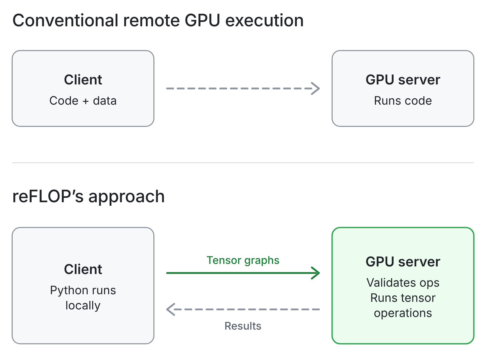

<div align="center">

# reFLOP

[](https://github.com/chaseungjoon/reflop/actions/workflows/ci.yml)
[](https://github.com/chaseungjoon/reflop/releases)
[](LICENSE)

[](docs/GUEST_GUIDE.md)
[](clib/README.md)
[](clib/README.md)
[](server/reflopd)
[](docs/OWNER_GUIDE.md)
[](docs/GUEST_GUIDE.md)

### Lend your GPU as a calculator.

Guests send tensor math. Never code execution, never shell access.

[Install](#install) · [Quick Start](#quick-start) · [How it works](#how-it-works) · [Security](#what-the-owner-is-protected-from) · [Docs](#more-information)

</div>

---

| | **Owner** | **Guest** |
|---|---|---|
| **Has** | the GPU workstation (Linux) | a laptop (macOS or Linux, no CUDA needed) |
| **Runs** | `reflopd` | their own PyTorch code, unchanged except for the device |
| **Gets** | a GPU that stays busy, and a machine that stays theirs | the GPU's FLOPs, and nothing else |

```python
import torch, reflop

dev = reflop.device()          # the GPU on the Owner's workstation
model = MyModel().to(dev)      # weights live on the server
for x, y in loader:
    loss = loss_fn(model(x.to(dev)), y.to(dev))
    loss.backward()
    opt.step(); opt.zero_grad()
    print(loss.item())         # only this number comes back
```

Already have a CUDA script? Don't touch it:

```sh
reflop run python train.py    # .cuda() and device="cuda" go to the Owner's GPU
```

> [!IMPORTANT]
> **The server never runs Guest code.** It accepts graphs over a closed set of
> 582 operators (571 PyTorch overloads, 11 reflop-native), validates them, and
> runs them in a sandboxed worker. No request can say "delete a file", "open a
> socket" or "start a process", so a Guest can't do any of those.

## Install

| Side | Platform | Needs |
|---|---|---|
| **Owner** installs `reflopd` | Linux x86_64 or aarch64, glibc ≥ 2.28 | nothing: no root, no Docker, no Python. NVIDIA driver ≥ 525 is optional (without a GPU, reflopd serves the CPU) |
| **Guest** installs `reflop` | macOS (Apple Silicon or Intel) or Linux | Python ≥ 3.10, PyTorch ≥ 2.6 |

---

### `reflop` Guest

> Add the client to the environment your training code runs in

- **uv or pip**

```sh
# Recommended
uv add reflop

# or
pip install reflop
```

This installs both the Python library (`import reflop`) and the `reflop` command in that environment.

- **Install script**

```sh
curl -fsSL https://raw.githubusercontent.com/chaseungjoon/reflop/main/install.sh | sh
```

The script installs into the active virtual environment if there is one, otherwise
into an environment of its own.

---

### `reflopd` Owner

> On the GPU workstation

- **Install script**

```sh
curl -fsSL https://raw.githubusercontent.com/chaseungjoon/reflop/main/install.sh | sh -s -- --server
```

`reflopd` goes to `~/.local/bin`. 

The download is checked against the
release's SHA-256 sums, and the sums against a signature made with the
project's offline release key (the check uses `ssh-keygen`, OpenSSH 8.1 or
newer).

---

### Update

```sh
reflop update      # Guest
reflopd update     # Owner
```

Each one updates only its own program to the newest release, after checking
the release signature. 

In a uv project, `reflop update` upgrades `reflop` in
`uv.lock` and syncs, so `uv run` keeps the new version. 

In a pip environment
it installs the release's wheel. `pip install -U reflop` and
`uv lock --upgrade-package reflop && uv sync` also work. The files on PyPI are
the files of the signed GitHub release.

<details>
<summary><b>From the Releases tab</b></summary>

<br>

Download `reflopd_<version>_linux_<arch>.tar.gz` or
`reflop-<version>-py3-none-any.whl` from
[Releases](https://github.com/chaseungjoon/reflop/releases) with `checksums.txt`
and `checksums.txt.sig`. Check the signature, then the file:

```sh
echo 'reflop-release ssh-ed25519 AAAAC3NzaC1lZDI1NTE5AAAAIKqs9C0dx4nGfqCL1Vw0hgwleOGNaDOPYyMBCwYU3lsW' > allowed_signers
ssh-keygen -Y verify -f allowed_signers -I reflop-release -n reflop-release -s checksums.txt.sig < checksums.txt
sha256sum --check --ignore-missing checksums.txt
```

Then put `reflopd` on your `PATH` or `pip install` the wheel.

</details>

<details>
<summary><b>Build from source</b></summary>

<br>

Requires Go (see `go.mod`) and, for the client, Python 3.10+:

```sh
git clone https://github.com/chaseungjoon/reflop.git && cd reflop
make build                                  # bin/reflopd, with the worker embedded
pip install ./client/python                 # the reflop client
```

</details>

## Quick Start

> Owner side `reflopd`
```sh
# 1) Set up and start (rootless).
reflopd up --listen <LAN-or-Tailscale-addr>:7460

# 2) One invite per Guest, prints the one-time pairing code
reflopd invite --name alice
```

> Guest side `reflop`
```sh
# 3) Pair once (the server key gets pinned), then check
reflop pair reflop1-baaraai2b4…
reflop status

# 4) Train your model
python reflop_train.py          # Embed `reflop` in code
reflop run python train.py      # Or just add a prefix command
```

## How it works

<p align="center">
  <picture>
    <source media="(prefers-color-scheme: dark)" srcset="docs/images/how-it-works-dark.png">
    
  </picture>
</p>

| Step | Where | What happens |
|---|---|---|
| **1. Record** | Guest | Every PyTorch operation on a `reflop` tensor is recorded instead of run. Shapes and dtypes are computed locally, so shape-dependent code needs no round trip. |
| **2. Send** | Guest → Owner | `loss.item()`, `print(t)` or `.cpu()` turns the recording into one graph. The graph is sent once; later steps send only its hash and the new inputs. |
| **3. Validate** | Owner | Strict decoding, the operator whitelist, schema and argument checks, shape inference on meta tensors, and a peak-memory estimate against the GPU's size, all before any GPU memory is allocated. Index arguments are bounds-checked before each kernel launches. |
| **4. Run** | Owner | One worker process per session, with no network, no `exec`, no `fork`, and no access to the Owner's files. Weights and optimizer state stay on the server between steps. |
| **5. Return** | Owner → Guest | Only what you asked for. Usually a few bytes: the loss. |

## What the Owner is protected from

| A Guest tries to | What happens |
|---|---|
| run a shell, a script, a pip package, a CUDA kernel | there is no request type for it; only whitelisted operators exist |
| read `~/.ssh`, the browser profile, other Guests' data | the worker's Landlock domain covers only its own scratch directory |
| open a socket, connect to localhost, `exec`, `fork`, `ptrace` | seccomp denies it after warm-up |
| index out of bounds to read GPU memory | bounds are checked before the kernel launches |
| read stale GPU memory with `torch.empty` | allocation-only operators return zeros |
| fill the disk or exhaust host RAM | safety rails: disk keeps max(10%, 20 GiB) free, host RAM keeps 4 GiB |
| hog the GPU | `reflopd pause`, `kill`, `yield --auto`; optional quotas |
| impersonate the server | the client pins the server key at pairing and refuses a different one |

> [!TIP]
> `reflopd doctor` shows which protections are active on your machine, and
> `reflopd selftest --security` checks them on a live worker. Details:
> [threat model](docs/THREAT_MODEL.md).

## Datasets

Decode and preprocess on your laptop, upload once, then send only batch indices:

```sh
reflop data build --from my_data:load --out ./cifar_pack   # runs your code locally
reflop data push ./cifar_pack --name cifar10               # resumable, verified per 4 MiB chunk
```

```python
ds = reflop.dataset("cifar10")
for batch in ds.loader(batch_size=128, shuffle=True, seed=0):
    x = batch["images"].float() / 255     # gathered on the server
    y = batch["labels"]
```

## Fast steady-state training

Eager mode records every operation each step, which costs tens of microseconds
per operation on the client. For steps whose graph does not change,
`reflop.capture` replays the step on the server without running your Python:

```python
step = reflop.capture(train_step)     # train_step(x, y) -> loss
for x, y in data:
    loss = step(x, y)                 # one request per step after two warm-up calls
```

ResNet-18, CIFAR-10 shapes, batch 128, RTX 5070, client on the same machine over TLS:

| Mode | Throughput vs plain PyTorch on the same GPU |
|---|---|
| `reflop.capture` | **74%** |
| eager | 19% |

Steps whose Python numbers change every step (a non-capturable Adam's bias
correction, a Python learning-rate schedule) are detected and refused; use
`capturable=True` or tensor learning rates.

## More Information

| | |
|---|---|
| `reflopd status` · `top` · `audit` | who is connected, live memory and FLOPs, the audit log |
| `reflopd pause` · `resume` · `kill alice` · `say "…"` | Owner controls |
| `reflopd revoke alice` · `users delete alice` | cut a Guest off; then remove them and their data |
| `reflopd yield --auto` | pause Guests while you use the GPU yourself |
| `reflopd quota set alice --device-memory 6GiB` | optional quotas (none by default) |
| `reflopd rails show` · `rails set --ram 8GiB` | safety rails (always on) |
| `reflopd invite --name bob --via ssh --key "ssh-ed25519 …"` | reuse `sshd`: a forced-command pipe, never a shell |
| `sudo reflopd install --system` | move reflopd into a dedicated system account |
| `reflop data build` · `push` · `ls` · `rm` | datasets |
| `reflop verify` | cross-check small graphs against your CPU |
| `with reflop.placement("local"):` | run part of the program on the client |

**Guides:** [Owner guide](docs/OWNER_GUIDE.md) (setup, exposure, Level 1, SSH mode, rails, quotas, troubleshooting)
· [Guest guide](docs/GUEST_GUIDE.md) (API, capture, datasets, placement, what works and what doesn't)
· [C and C++ API](clib/README.md) (`libreflop` for non-Python programs)

**Design:** [Threat model](docs/THREAT_MODEL.md) · [Design decisions](docs/DECISIONS.md) · [Spike report](docs/SPIKE_REPORT.md) · [Operator set](docs/OPSET.md)

> [!WARNING]
> **Limitations**
> - The Owner can see Guests' data and models. reFLOP protects the Owner's machine from Guests, not the other way around.
> - No arbitrary CPU programs, custom CUDA or Triton kernels, or server-side image and text decoding.
> - GPU results can differ bitwise from local runs (TF32, non-deterministic kernels).
> - Killing a worker loses its session state.
>
> [All limitations](docs/THREAT_MODEL.md#known-limitations)

## reFLOP vs recom

| | Use it for | Access |
|---|---|---|
| [recom](https://github.com/chaseungjoon/recom) | your own remote machine | full shell over SSH |
| **reFLOP** | a GPU shared with people you don't fully trust | whitelisted tensor operators only |

## Development

```sh
make build              # bin/reflopd
make test               # Go tests (race) and Python tests
make lint               # gofmt, go vet, ruff, and the I1/I2 static check
make build-probes       # test build with isolation probes (never ship it)
make test-isolation     # run the probes inside real sandboxed workers
make clib               # libreflop and the C/C++ examples
```

See [CONTRIBUTING.md](CONTRIBUTING.md) and [SECURITY.md](SECURITY.md).

## License

[Apache-2.0](LICENSE)
