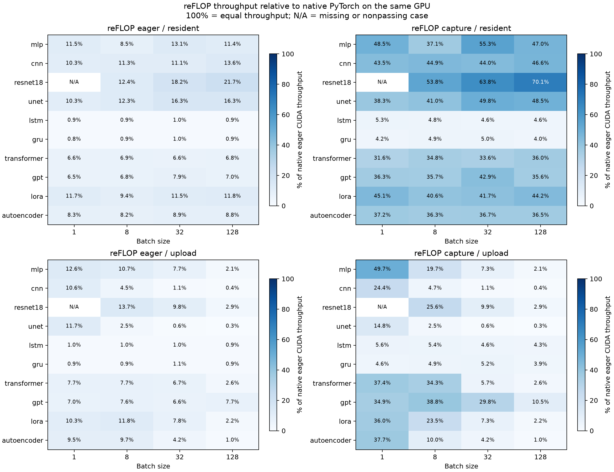

# reFLOP benchmark results — 15 November 2026 (UTC)

**At batch 128 with resident inputs, reFLOP capture retains 35.6–70.1% of native eager GPU throughput for eight workloads; LSTM and GRU retain 4.0–4.6%.** Native PyTorch ran locally on the Linux Owner workstation. The Guest ran on a MacBook Pro over Tailscale TLS to the same RTX 5070. Uploading inputs every step reduces capture throughput to 0.26–10.52% of the corresponding native upload baseline.

These are measured timing ratios, not numerical validation. The available correctness evidence still contains unresolved ResNet-18 failures. The [14 November analysis](historical-2026-11-14.md) and the root README's same-machine 74% ResNet result are separate experiments; neither supplies this comparison's baseline.

## Runs and measurement conditions

The run IDs use UTC: these runs were collected on 15 November UTC, or 16 November in Asia/Seoul.

| Evidence | Run ID | Outcome |
| --- | --- | --- |
| Native eager CUDA, Owner workstation | `20261115T151140Z-native_cuda-b37a7467` | 78 passed |
| Remote throughput, MacBook Pro Guest | `20261115T152437Z-throughput-0bbfc8c4` | 162 passed: 156 workload cases + 6 synchronization cases |
| Generated comparison | `20261115T155059Z-cuda-comparison-13d663ca` | 156 matched pairs; no failed or missing pairs |

Each native workload/batch/input-policy case is the baseline for both remote eager and capture. The six synchronization cases are excluded from the native comparison. ResNet-18 batch 1 is excluded from both performance matrices because training-mode BatchNorm cannot use its `[1, 512, 1, 1]` activation.

| Setting | Recorded value |
| --- | --- |
| GPU | NVIDIA GeForce RTX 5070, 12,322,603,008 bytes; same physical GPU confirmed by the operator |
| Native host | Linux x86_64, Python 3.12.13 |
| Guest | MacBook Pro (operator-reported), macOS 27.2.1 arm64, Python 3.12.16, PyTorch 2.15.0 |
| reFLOP | Client 0.1.12; `reflopd` 0.1.12 |
| Native and Owner runtime | PyTorch 2.15.0+cu132, CUDA 13.2 |
| Owner driver | 595.71.05; the native run did not separately record its driver |
| Numerical policy | cuDNN TF32 enabled; matmul TF32, deterministic algorithms, and cuDNN benchmark disabled |
| Source | Commit `2e1e02419f00ac4bfeec8c6eaab08a99da7411cd`, clean working trees; matching benchmark and training-source hashes |
| Timing | 5 warmup steps, then 3 synchronized windows of 30 steps; synchronization at each window's end |
| Configuration | Seed 1729, 4 CPU threads, batches 1/8/32/128, momentum optimizer |
| Connection | Tailscale TLS, reported by the operator |

RTT, effective bandwidth, physical distance, direct versus relayed Tailscale routing, GPU clocks/power limits, and competing GPU load were not recorded in the supplied evidence. This is a measured remote-use scenario, not a controlled LAN/WAN comparison or a test isolating TLS overhead. The configuration's `native_cuda_label` remains its default placeholder; the host/path description above comes from the operator.

## Retained native GPU throughput

```text
retained throughput = remote samples/second / native samples/second × 100%
samples/second = batch size / mean synchronized seconds/step
```

Equal-length windows make this equivalent to total samples divided by total timed window duration. The tables use unrounded values for ratios, then round for display. They do not average repeat rates or use per-step submission time. Each workload's sample has a different shape and cost, so compare modes within a workload.

The timed region includes forward, loss, zero-grad, backward, optimizer, the selected input transfers, and final synchronization. It excludes connection setup, model initialization, initial weight transfer, and warmup. All inputs and weights are synthetic. The baseline is native eager PyTorch, not native CUDA graphs or `torch.compile`.



The heatmap covers all 156 comparisons. ResNet-18 batch 1 is `N/A` because it is excluded, not because a timed case failed. ResNet-18 timing remains provisional pending correctness investigation. See the [full table](comparison.md), [CSV](data/comparison.csv), or [JSON](data/comparison.json) for every point.

### Resident inputs, batch 128

| Workload | Native samples/s | reFLOP eager samples/s | reFLOP capture samples/s | Eager / native | Capture / native |
| --- | ---: | ---: | ---: | ---: | ---: |
| MLP | 653,913 | 74,326 | 307,320 | 11.4% | 47.0% |
| CNN | 274,215 | 37,225 | 127,725 | 13.6% | 46.6% |
| ResNet-18* | 31,973 | 6,938 | 22,415 | 21.7% | 70.1% |
| U-Net | 270,670 | 44,141 | 131,318 | 16.3% | 48.5% |
| LSTM | 237,769 | 2,233 | 10,934 | 0.9% | 4.6% |
| GRU | 259,952 | 2,246 | 10,276 | 0.9% | 4.0% |
| Attention classifier | 224,861 | 15,224 | 80,850 | 6.8% | 36.0% |
| GPT | 213,965 | 14,907 | 76,068 | 7.0% | 35.6% |
| LoRA-style | 532,143 | 62,627 | 235,443 | 11.8% | 44.2% |
| Autoencoder | 637,164 | 55,785 | 232,463 | 8.8% | 36.5% |

*ResNet-18 has unresolved failures in the historical correctness evidence; no fresh correctness artifacts were supplied with this comparison.*

Capture improves resident throughput by 2.97–5.31× over eager at batch 128. That improvement does not imply near-native performance: LSTM and GRU improve 4.90× and 4.57× over remote eager yet retain only 4.6% and 4.0% of native throughput. Their captured steps take 11.707 and 12.456 ms, versus 0.538 and 0.492 ms natively. These timings do not isolate the cause of that gap.

ResNet-18 resident capture takes 5.710 ms/step versus 4.003 ms natively, retaining 70.1%; remote eager takes 18.449 ms, retaining 21.7%. This does not establish that the design's LAN performance target has passed: network conditions were not controlled and correctness remains unresolved.

### Uploaded inputs, batch 128

The native upload baseline copies CPU inputs over the Owner's local bus. reFLOP uploads them over the Guest-to-Owner connection. This is the user-visible cost of that input policy; it is not a comparison of identical transfer paths.

| Workload | Native upload samples/s | reFLOP capture upload samples/s | Capture / native upload |
| --- | ---: | ---: | ---: |
| MLP | 508,061 | 10,543 | 2.08% |
| CNN | 219,562 | 901 | 0.41% |
| ResNet-18* | 30,885 | 895 | 2.90% |
| U-Net | 209,515 | 542 | 0.26% |
| LSTM | 236,880 | 10,107 | 4.27% |
| GRU | 255,138 | 9,964 | 3.91% |
| Attention classifier | 203,552 | 5,230 | 2.57% |
| GPT | 186,259 | 19,603 | 10.52% |
| LoRA-style | 479,703 | 10,490 | 2.19% |
| Autoencoder | 515,637 | 5,353 | 1.04% |

For ResNet-18, remote eager and capture with uploads both take about 143 ms/step, compared with 5.710 ms for resident capture. Capture alone does little for this upload-heavy case. Resident cases reuse one batch already on the GPU; they do not measure staging a complete dataset, changing remote batches, augmentation, or a production data loader.

## Correctness and limits

All 78 native and 162 remote timing cases passed their timing checks. A timing pass checks finite loss and, for capture, replay; it does not establish full loss, gradient, parameter, or buffer equivalence.

The supplied new artifacts contain native and remote throughput runs and their comparison, but no new inventory or correctness run. The retained [14 November run summary](data/run-summary.json) reports 36 correctness passes and 4 failures, all ResNet-18 (eager/capture × remote CUDA/server CPU). CUDA loss differed from the native CPU reference by about 1.7%, beyond `rtol=0.002`, `atol=0.0002`; CPU checks had 7/512 tensor mismatches with maximum absolute difference about 0.000456. Those checks used reFLOP 0.1.11 and cannot certify this 0.1.12 run. The new native throughput baseline does not resolve them. Investigate with matched native CUDA correctness checks and intermediate values; do not loosen tolerances merely to obtain a pass.

Three sequential timing windows per case provide repeat observations, not confidence intervals. Separate native and remote runs do not control time-varying load or GPU power state. No measured concurrency, transfer, soak, recovery, isolation, or WAN suite results are supplied here. These results describe the synthetic workload matrix and this connection, not training convergence or general model compatibility.

## Files and reproduction

- [data/comparison.json](data/comparison.json) and [data/comparison.csv](data/comparison.csv): byte-for-byte copies from the generated comparison directory, including source run IDs and, in JSON, SHA-256 hashes of both raw `results.jsonl` files.
- [data/comparison-context.json](data/comparison-context.json): selected runtime, configuration, provenance, and synchronized repeat timings from both runs; operator-reported setup is labeled separately. Connection addresses, session IDs, and local paths are omitted.
- [comparison.md](comparison.md): the full generated table with report-relative links.
- [figures/native-cuda-comparison.png](figures/native-cuda-comparison.png) and [SVG](figures/native-cuda-comparison.svg): the generated comparison chart, re-rendered from the same JSON with reFLOP branding.
- [historical-2026-11-14.md](historical-2026-11-14.md): earlier analysis. Its `data/throughput.*`, `data/run-summary.json`, and four original figure pairs remain separate from this comparison.

Reviewed copies live outside ignored `benchmark/results/`; the original generated results are unchanged. From the repository root, reproduce the comparison using the original completed runs:

```bash
uv pip install --python benchmark/.venv/bin/python -r benchmark/requirements-plots.txt
BENCH_REMOTE_RUN="$PWD/benchmark/results/20261115T152437Z-throughput-0bbfc8c4" \
BENCH_NATIVE_RUN="$PWD/benchmark/results/20261115T151140Z-native_cuda-b37a7467" \
BENCH_SAME_GPU=1 ./benchmark/scripts/compare_cuda.sh
```

This writes a new ignored comparison directory without GPU work. To render only the chart and full table from the reviewed JSON, use a new output directory:

```bash
benchmark/.venv/bin/python - <<'PY'
import json
import tempfile
from pathlib import Path
from benchmark.bench.compare_cuda import render

data = json.loads(Path("benchmark/report/data/comparison.json").read_text())
output = Path(tempfile.mkdtemp(prefix="reflop-comparison-")) / "rendered"
render(data, output)
print(output)
PY
```

The separate `benchmark/scripts/plot_results.py` still renders the historical 14 November snapshot by default. It does not regenerate this native comparison or its narrative. Follow the [benchmark guide](../README.md#compare-native-gpu-and-reflop-throughput) for fresh collection; review correctness evidence and measurement conditions before replacing this report.
