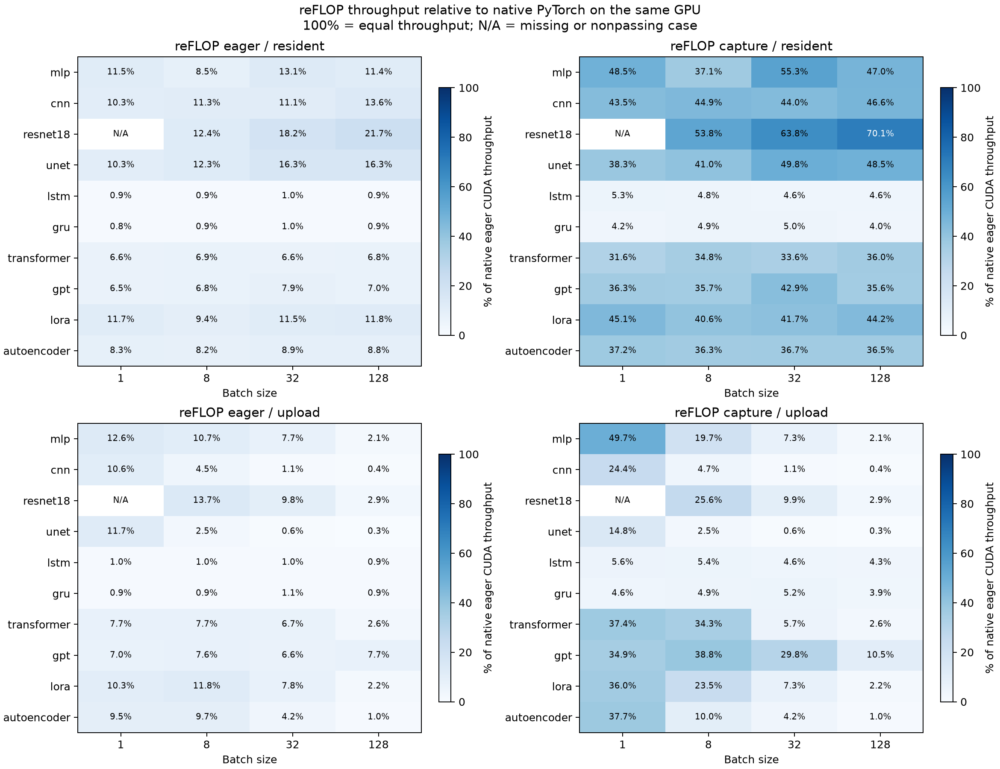

# reFLOP native CUDA comparison

[Analysis, measurement conditions, and correctness limitations](README.md). ResNet-18 correctness remains unresolved in the available evidence.

Remote run: `20261115T152437Z-throughput-0bbfc8c4`. Native run: `20261115T151140Z-native_cuda-b37a7467`.

Retained throughput = remote samples/s / native samples/s × 100%. The operator confirmed the same physical GPU.

The baseline is native eager PyTorch. Results above 100% are retained as measured and need investigation, including run-to-run noise.

| Workload | Batch | Mode | Inputs | Remote ms/step | Native ms/step | Retained throughput |
| --- | ---: | --- | --- | ---: | ---: | ---: |
| mlp | 1 | eager | resident | 1.693 | 0.195 | 11.5% |
| mlp | 1 | eager | upload | 1.793 | 0.226 | 12.6% |
| mlp | 1 | capture | resident | 0.403 | 0.195 | 48.5% |
| mlp | 1 | capture | upload | 0.455 | 0.226 | 49.7% |
| mlp | 8 | eager | resident | 1.711 | 0.146 | 8.5% |
| mlp | 8 | eager | upload | 1.837 | 0.196 | 10.7% |
| mlp | 8 | capture | resident | 0.394 | 0.146 | 37.1% |
| mlp | 8 | capture | upload | 0.998 | 0.196 | 19.7% |
| mlp | 32 | eager | resident | 1.681 | 0.219 | 13.1% |
| mlp | 32 | eager | upload | 3.290 | 0.252 | 7.7% |
| mlp | 32 | capture | resident | 0.397 | 0.219 | 55.3% |
| mlp | 32 | capture | upload | 3.457 | 0.252 | 7.3% |
| mlp | 128 | eager | resident | 1.722 | 0.196 | 11.4% |
| mlp | 128 | eager | upload | 12.209 | 0.252 | 2.1% |
| mlp | 128 | capture | resident | 0.417 | 0.196 | 47.0% |
| mlp | 128 | capture | upload | 12.141 | 0.252 | 2.1% |
| cnn | 1 | eager | resident | 3.190 | 0.330 | 10.3% |
| cnn | 1 | eager | upload | 3.297 | 0.351 | 10.6% |
| cnn | 1 | capture | resident | 0.759 | 0.330 | 43.5% |
| cnn | 1 | capture | upload | 1.437 | 0.351 | 24.4% |
| cnn | 8 | eager | resident | 3.220 | 0.362 | 11.3% |
| cnn | 8 | eager | upload | 9.752 | 0.438 | 4.5% |
| cnn | 8 | capture | resident | 0.807 | 0.362 | 44.9% |
| cnn | 8 | capture | upload | 9.351 | 0.438 | 4.7% |
| cnn | 32 | eager | resident | 3.222 | 0.357 | 11.1% |
| cnn | 32 | eager | upload | 36.320 | 0.398 | 1.1% |
| cnn | 32 | capture | resident | 0.810 | 0.357 | 44.0% |
| cnn | 32 | capture | upload | 35.807 | 0.398 | 1.1% |
| cnn | 128 | eager | resident | 3.439 | 0.467 | 13.6% |
| cnn | 128 | eager | upload | 142.080 | 0.583 | 0.4% |
| cnn | 128 | capture | resident | 1.002 | 0.467 | 46.6% |
| cnn | 128 | capture | upload | 142.128 | 0.583 | 0.4% |
| resnet18 | 8 | eager | resident | 18.681 | 2.319 | 12.4% |
| resnet18 | 8 | eager | upload | 18.986 | 2.600 | 13.7% |
| resnet18 | 8 | capture | resident | 4.310 | 2.319 | 53.8% |
| resnet18 | 8 | capture | upload | 10.165 | 2.600 | 25.6% |
| resnet18 | 32 | eager | resident | 18.595 | 3.375 | 18.2% |
| resnet18 | 32 | eager | upload | 36.987 | 3.624 | 9.8% |
| resnet18 | 32 | capture | resident | 5.292 | 3.375 | 63.8% |
| resnet18 | 32 | capture | upload | 36.779 | 3.624 | 9.9% |
| resnet18 | 128 | eager | resident | 18.449 | 4.003 | 21.7% |
| resnet18 | 128 | eager | upload | 143.067 | 4.144 | 2.9% |
| resnet18 | 128 | capture | resident | 5.710 | 4.003 | 70.1% |
| resnet18 | 128 | capture | upload | 142.977 | 4.144 | 2.9% |
| unet | 1 | eager | resident | 2.654 | 0.275 | 10.3% |
| unet | 1 | eager | upload | 2.727 | 0.320 | 11.7% |
| unet | 1 | capture | resident | 0.716 | 0.275 | 38.3% |
| unet | 1 | capture | upload | 2.167 | 0.320 | 14.8% |
| unet | 8 | eager | resident | 2.646 | 0.325 | 12.3% |
| unet | 8 | eager | upload | 15.415 | 0.385 | 2.5% |
| unet | 8 | capture | resident | 0.794 | 0.325 | 41.0% |
| unet | 8 | capture | upload | 15.371 | 0.385 | 2.5% |
| unet | 32 | eager | resident | 2.504 | 0.408 | 16.3% |
| unet | 32 | eager | upload | 59.543 | 0.360 | 0.6% |
| unet | 32 | capture | resident | 0.820 | 0.408 | 49.8% |
| unet | 32 | capture | upload | 59.530 | 0.360 | 0.6% |
| unet | 128 | eager | resident | 2.900 | 0.473 | 16.3% |
| unet | 128 | eager | upload | 236.337 | 0.611 | 0.3% |
| unet | 128 | capture | resident | 0.975 | 0.473 | 48.5% |
| unet | 128 | capture | upload | 236.269 | 0.611 | 0.3% |
| lstm | 1 | eager | resident | 56.818 | 0.524 | 0.9% |
| lstm | 1 | eager | upload | 56.462 | 0.559 | 1.0% |
| lstm | 1 | capture | resident | 9.902 | 0.524 | 5.3% |
| lstm | 1 | capture | upload | 10.006 | 0.559 | 5.6% |
| lstm | 8 | eager | resident | 56.962 | 0.499 | 0.9% |
| lstm | 8 | eager | upload | 56.536 | 0.570 | 1.0% |
| lstm | 8 | capture | resident | 10.422 | 0.499 | 4.8% |
| lstm | 8 | capture | upload | 10.660 | 0.570 | 5.4% |
| lstm | 32 | eager | resident | 57.357 | 0.553 | 1.0% |
| lstm | 32 | eager | upload | 57.144 | 0.547 | 1.0% |
| lstm | 32 | capture | resident | 12.053 | 0.553 | 4.6% |
| lstm | 32 | capture | upload | 11.977 | 0.547 | 4.6% |
| lstm | 128 | eager | resident | 57.320 | 0.538 | 0.9% |
| lstm | 128 | eager | upload | 57.873 | 0.540 | 0.9% |
| lstm | 128 | capture | resident | 11.707 | 0.538 | 4.6% |
| lstm | 128 | capture | upload | 12.665 | 0.540 | 4.3% |
| gru | 1 | eager | resident | 56.239 | 0.453 | 0.8% |
| gru | 1 | eager | upload | 56.972 | 0.506 | 0.9% |
| gru | 1 | capture | resident | 10.710 | 0.453 | 4.2% |
| gru | 1 | capture | upload | 10.998 | 0.506 | 4.6% |
| gru | 8 | eager | resident | 57.012 | 0.488 | 0.9% |
| gru | 8 | eager | upload | 56.583 | 0.501 | 0.9% |
| gru | 8 | capture | resident | 9.990 | 0.488 | 4.9% |
| gru | 8 | capture | upload | 10.119 | 0.501 | 4.9% |
| gru | 32 | eager | resident | 56.780 | 0.583 | 1.0% |
| gru | 32 | eager | upload | 57.379 | 0.617 | 1.1% |
| gru | 32 | capture | resident | 11.687 | 0.583 | 5.0% |
| gru | 32 | capture | upload | 11.753 | 0.617 | 5.2% |
| gru | 128 | eager | resident | 56.981 | 0.492 | 0.9% |
| gru | 128 | eager | upload | 57.454 | 0.502 | 0.9% |
| gru | 128 | capture | resident | 12.456 | 0.492 | 4.0% |
| gru | 128 | capture | upload | 12.846 | 0.502 | 3.9% |
| transformer | 1 | eager | resident | 8.506 | 0.559 | 6.6% |
| transformer | 1 | eager | upload | 8.664 | 0.670 | 7.7% |
| transformer | 1 | capture | resident | 1.771 | 0.559 | 31.6% |
| transformer | 1 | capture | upload | 1.789 | 0.670 | 37.4% |
| transformer | 8 | eager | resident | 8.450 | 0.584 | 6.9% |
| transformer | 8 | eager | upload | 8.772 | 0.677 | 7.7% |
| transformer | 8 | capture | resident | 1.676 | 0.584 | 34.8% |
| transformer | 8 | capture | upload | 1.973 | 0.677 | 34.3% |
| transformer | 32 | eager | resident | 8.619 | 0.571 | 6.6% |
| transformer | 32 | eager | upload | 8.746 | 0.585 | 6.7% |
| transformer | 32 | capture | resident | 1.701 | 0.571 | 33.6% |
| transformer | 32 | capture | upload | 10.207 | 0.585 | 5.7% |
| transformer | 128 | eager | resident | 8.408 | 0.569 | 6.8% |
| transformer | 128 | eager | upload | 24.307 | 0.629 | 2.6% |
| transformer | 128 | capture | resident | 1.583 | 0.569 | 36.0% |
| transformer | 128 | capture | upload | 24.474 | 0.629 | 2.6% |
| gpt | 1 | eager | resident | 8.385 | 0.543 | 6.5% |
| gpt | 1 | eager | upload | 8.381 | 0.587 | 7.0% |
| gpt | 1 | capture | resident | 1.497 | 0.543 | 36.3% |
| gpt | 1 | capture | upload | 1.685 | 0.587 | 34.9% |
| gpt | 8 | eager | resident | 8.359 | 0.567 | 6.8% |
| gpt | 8 | eager | upload | 8.684 | 0.661 | 7.6% |
| gpt | 8 | capture | resident | 1.586 | 0.567 | 35.7% |
| gpt | 8 | capture | upload | 1.704 | 0.661 | 38.8% |
| gpt | 32 | eager | resident | 8.415 | 0.666 | 7.9% |
| gpt | 32 | eager | upload | 8.710 | 0.578 | 6.6% |
| gpt | 32 | capture | resident | 1.553 | 0.666 | 42.9% |
| gpt | 32 | capture | upload | 1.941 | 0.578 | 29.8% |
| gpt | 128 | eager | resident | 8.586 | 0.598 | 7.0% |
| gpt | 128 | eager | upload | 8.873 | 0.687 | 7.7% |
| gpt | 128 | capture | resident | 1.683 | 0.598 | 35.6% |
| gpt | 128 | capture | upload | 6.529 | 0.687 | 10.5% |
| lora | 1 | eager | resident | 1.943 | 0.227 | 11.7% |
| lora | 1 | eager | upload | 1.973 | 0.204 | 10.3% |
| lora | 1 | capture | resident | 0.503 | 0.227 | 45.1% |
| lora | 1 | capture | upload | 0.566 | 0.204 | 36.0% |
| lora | 8 | eager | resident | 2.030 | 0.191 | 9.4% |
| lora | 8 | eager | upload | 2.006 | 0.236 | 11.8% |
| lora | 8 | capture | resident | 0.471 | 0.191 | 40.6% |
| lora | 8 | capture | upload | 1.007 | 0.236 | 23.5% |
| lora | 32 | eager | resident | 1.918 | 0.220 | 11.5% |
| lora | 32 | eager | upload | 3.318 | 0.257 | 7.8% |
| lora | 32 | capture | resident | 0.528 | 0.220 | 41.7% |
| lora | 32 | capture | upload | 3.514 | 0.257 | 7.3% |
| lora | 128 | eager | resident | 2.044 | 0.241 | 11.8% |
| lora | 128 | eager | upload | 12.253 | 0.267 | 2.2% |
| lora | 128 | capture | resident | 0.544 | 0.241 | 44.2% |
| lora | 128 | capture | upload | 12.203 | 0.267 | 2.2% |
| autoencoder | 1 | eager | resident | 2.224 | 0.184 | 8.3% |
| autoencoder | 1 | eager | upload | 2.313 | 0.219 | 9.5% |
| autoencoder | 1 | capture | resident | 0.495 | 0.184 | 37.2% |
| autoencoder | 1 | capture | upload | 0.580 | 0.219 | 37.7% |
| autoencoder | 8 | eager | resident | 2.356 | 0.192 | 8.2% |
| autoencoder | 8 | eager | upload | 2.665 | 0.260 | 9.7% |
| autoencoder | 8 | capture | resident | 0.530 | 0.192 | 36.3% |
| autoencoder | 8 | capture | upload | 2.607 | 0.260 | 10.0% |
| autoencoder | 32 | eager | resident | 2.217 | 0.198 | 8.9% |
| autoencoder | 32 | eager | upload | 6.422 | 0.269 | 4.2% |
| autoencoder | 32 | capture | resident | 0.539 | 0.198 | 36.7% |
| autoencoder | 32 | capture | upload | 6.392 | 0.269 | 4.2% |
| autoencoder | 128 | eager | resident | 2.295 | 0.201 | 8.8% |
| autoencoder | 128 | eager | upload | 24.252 | 0.248 | 1.0% |
| autoencoder | 128 | capture | resident | 0.551 | 0.201 | 36.5% |
| autoencoder | 128 | capture | upload | 23.913 | 0.248 | 1.0% |

A timing pass checks finite loss, not full numerical equivalence. Read the separate correctness results before treating a workload as validated.
See [comparison.csv](data/comparison.csv) for absolute sample rates and all matched/unavailable cases. Repeat samples remain in the source runs. These ratios have no confidence intervals.
