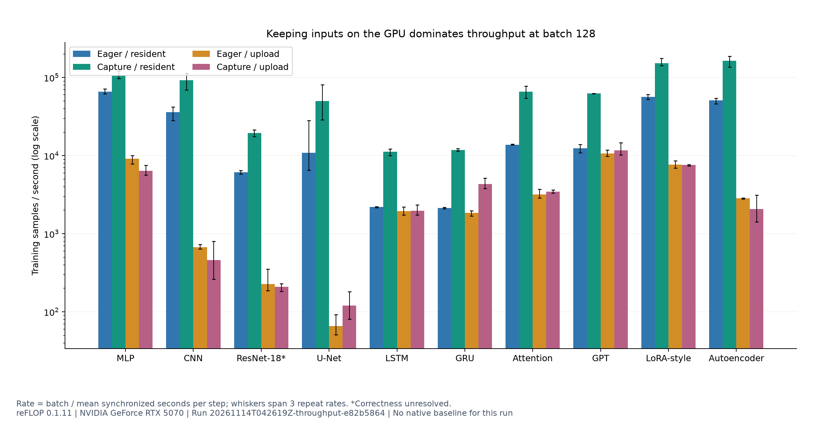
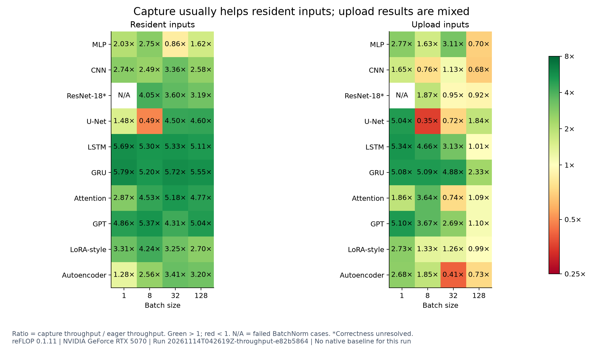
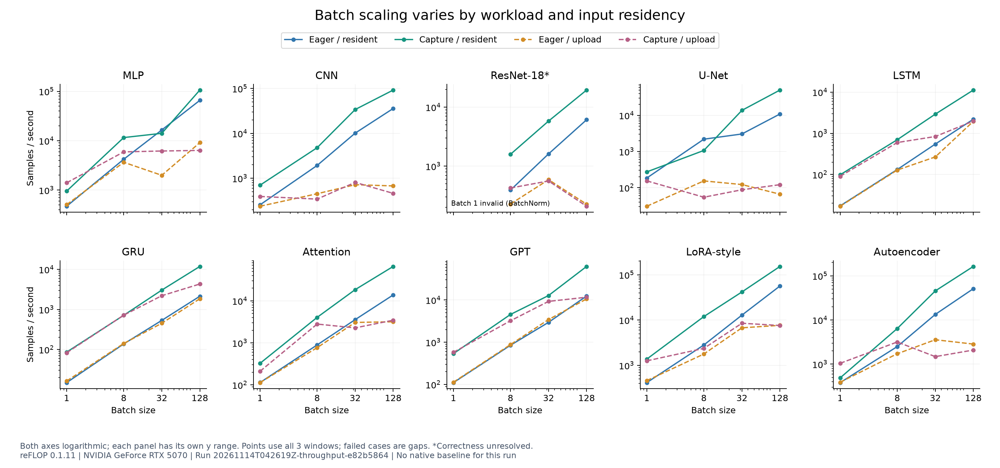
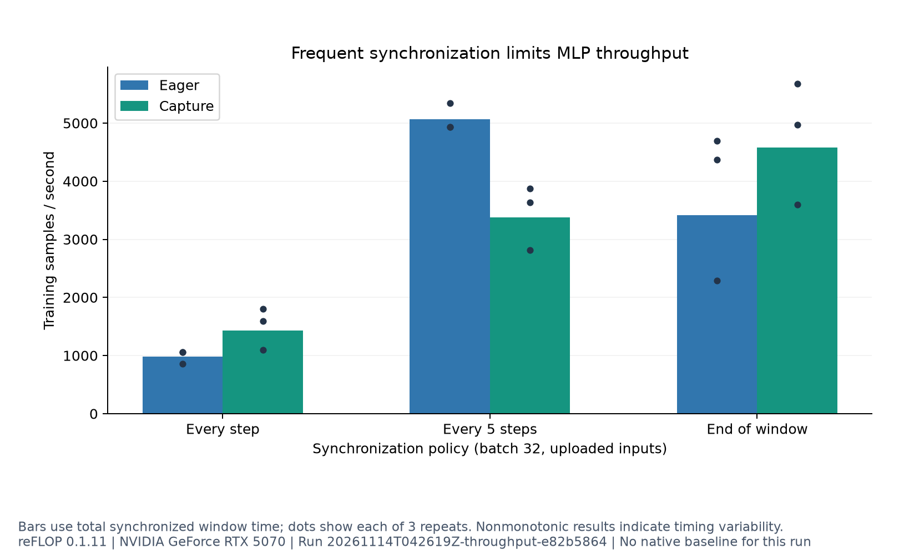

# reFLOP benchmark results — 14 November 2026

> Historical analysis of the 14 November run. For the matched 15 November native GPU comparison from a MacBook Pro over Tailscale TLS, see the [current report](README.md).

**reFLOP capture delivers substantial improvements over reFLOP eager when training inputs remain on the GPU. Uploading inputs every step can overwhelm those gains.** This is evidence for capture and data residency, not a measurement of efficiency relative to native CUDA: no matched native baseline was collected for this run.

## What was measured

The client was macOS arm64, Python 3.12.16, PyTorch 2.15.0, reFLOP 0.1.11. The remote runtime reported an NVIDIA GeForce RTX 5070 (12,322,603,008 bytes), `reflopd` 0.1.11, PyTorch 2.15.0+cu132, CUDA 13.2, and cuDNN TF32 enabled. Inventory observed authenticated TLS 1.3. Network RTT, physical distance, and effective link bandwidth were not measured; do not describe this as a controlled LAN or WAN result.

Throughput run: `20261114T042619Z-throughput-e82b5864`. Ten synthetic training workloads × four batch sizes × eager/capture × resident/upload = 160 cases, plus six MLP synchronization cases. Each successful case had five warmup steps, then three windows of 30 steps. The measured region includes forward, loss, zero-grad, backward, momentum optimizer, selected input uploads, and final synchronization. Model initialization, initial weight transfer, warmup, and connection setup are excluded.

All charts use **batch size divided by the arithmetic mean of synchronized repeat seconds/step**, equivalent to total samples / total window time because windows have equal step counts. They do not use per-step submission time or the arithmetic mean of repeat rates. Whiskers/dots show observed repeats, not confidence intervals. Each model's “sample” differs in shape and computational cost; compare modes within a workload, rather than ranking model efficiency by sample rate.

## Throughput and input residency



At batch 128, resident capture improves throughput by **1.62–5.55×** over resident eager across all ten workloads. Keep training data near the GPU and replay stable training graphs.

| Workload | Eager resident samples/s | Capture resident samples/s | Capture / eager | Capture upload samples/s | Resident / upload, capture |
| --- | ---: | ---: | ---: | ---: | ---: |
| MLP | 65,757 | 106,288 | 1.62× | 6,363 | 16.70× |
| CNN | 35,915 | 92,534 | 2.58× | 460 | 201.13× |
| ResNet-18* | 6,112 | 19,511 | 3.19× | 209 | 93.54× |
| U-Net | 10,904 | 50,165 | 4.60× | 120 | 416.53× |
| LSTM | 2,195 | 11,225 | 5.11× | 1,977 | 5.68× |
| GRU | 2,137 | 11,865 | 5.55× | 4,318 | 2.75× |
| Attention classifier | 13,850 | 66,025 | 4.77× | 3,463 | 19.07× |
| GPT | 12,405 | 62,479 | 5.04× | 11,654 | 5.36× |
| LoRA-style | 56,640 | 153,142 | 2.70× | 7,593 | 20.17× |
| Autoencoder | 51,162 | 163,510 | 3.20× | 2,083 | 78.49× |

*ResNet-18 performance is provisional because its separate correctness checks failed.*

The largest residency ratios are comparisons between different data policies, not capture speedups or GPU acceleration ratios. Resident cases reuse the same synthetic batch already on the device. They represent a favorable steady state; they do not include staging a full dataset, changing remote batches, augmentation, or a production input pipeline. Those require the dataset suite and realistic workloads.

The counters support the data-movement explanation: CNN batch 128 uploads 47,216,640 bytes per 30-step window in both eager and capture, versus zero timed input-upload bytes for resident runs. Both resident modes record 30 executes per window. Capture reduces client flushes from 30 to zero, with no new timed registrations. Replay therefore does not mean all 30 steps become one server execute. These counters support reduced client graph-building work and eliminated repeated input traffic; they do not isolate every source of elapsed time.

## Capture gains depend on batch and workload



Capture helps most resident cases, but not all: resident MLP batch 32 is 0.86× eager, and resident U-Net batch 8 is 0.49×. Upload results are mixed. At batch 128, capture/upload is 0.70× eager/upload for MLP and 0.68× for CNN, while GRU improves 2.33×. Capture is an optimization to measure for each workload, not a universal speedup guarantee. With only three sequential windows and no randomized case ordering, timing variation and server load cannot be separated from implementation effects.



Larger batches often amortize fixed per-step overhead when inputs are resident. Upload throughput frequently flattens or worsens as batches grow, consistent with increased transfer cost. The scaling plot preserves counterexamples and missing results; its panels use separate logarithmic y scales.

## Synchronization matters



For uploaded MLP batch 32, eager measures 983 samples/s with a synchronization every step, 5,061 every five steps, and 3,414 at the end of the window. Capture measures 1,435, 3,377, and 4,580 respectively. Avoiding a wait after every step can substantially improve throughput. The nonmonotonic eager results and repeat spread show that these short runs do not establish a precise optimal synchronization interval or a tail-latency guarantee.

## Correctness and scope of evidence

| Saved invocation | Outcome |
| --- | --- |
| Catalog | 1,396 planned cases; catalog only, not execution |
| Smoke | 12 passed |
| Inventory | 6 passed |
| Correctness | 36 passed, 4 failed |
| Throughput including synchronization | 162 passed, 4 failed |

The four throughput failures are all ResNet-18 batch 1. Its 32×32 inputs reach a `[1, 512, 1, 1]` activation, which is invalid for training-mode BatchNorm. No server execute was recorded. This is an invalid workload configuration, not evidence of reFLOP throughput failure. The current catalog excludes this batch; the historical failures remain in the snapshot.

All four correctness failures are ResNet-18 (eager/capture × remote CUDA/server CPU). CUDA loss differs from the native CPU reference by roughly 1.7%, exceeding `rtol=0.002`, `atol=0.0002`. Server CPU cases reach a tensor comparison with 7/512 mismatches and maximum absolute difference about 0.000456. Possible contributors include numerical backend differences and enabled cuDNN TF32; the evidence does not establish a cause or prove harmlessness. Investigate with a matched native CUDA reference, controlled numerical settings, and intermediate comparisons before making a correctness claim. Do not relax tolerances merely to obtain a pass.

A throughput pass asserts timing completed with finite loss (and capture replay where applicable). It is not the full loss/gradient/parameter correctness check. The correctness suite uses SGD, batch 8, eight steps, and changing inputs; throughput uses momentum and repeated inputs across many more steps. Even the 36 correctness passes are evidence for those specific configurations, not validation of every performance point.

Only these saved invocations were available. The remaining catalog suites—including concurrency, transfer, soak, recovery, isolation, and WAN—have no measured results here. There are no native CPU or native CUDA throughput runs. To measure retained GPU throughput, run `native_cuda.sh` on the same owner GPU with matched model, batch, input policy, steps, numerical settings, and versions, then calculate `remote samples/s / native samples/s × 100%`. The baseline is native eager PyTorch; compare against optimized native execution separately if that is the intended claim.

## Native GPU comparison for this historical run

These saved results contain no native CUDA baseline. They cannot establish the percentage of native GPU throughput retained by reFLOP. The root README's 74% ResNet capture result is a separate same-machine experiment and cannot be combined with this run.

Follow the [native comparison workflow](../README.md#compare-native-gpu-and-reflop-throughput) to collect both runs from the current source and generate percentage, samples/second, and milliseconds/step comparisons. The comparator requires matching training-source hashes, runtime versions, numerical policies, and configuration. Collect a fresh remote run alongside the native baseline after changing the harness; do not compare an old run against a different workload implementation.

The harness now defaults to this repository's source client and C/C++ API. The current catalog excludes ResNet-18 batch 1, reducing the default catalog from the historical 1,396 cases to 1,388. The JSON snapshots and graphs here retain the original run and all eight failures across correctness and throughput. The numerical ResNet failures remain unresolved.

## Files and reproduction

- `figures/`: four graphs in PNG for Markdown and SVG for reuse.
- `data/throughput.json`: selected measurement fields, repeat timings, counters, runtime metadata, effective configuration, and SHA-256 of the original `results.jsonl`. Connection history, addresses, session IDs, local paths, and logs are omitted from this snapshot of the supplied run.
- `data/throughput.csv`: one row per throughput case, including failures and repeat timings.
- `data/run-summary.json`: saved run counts and all nonpassing case messages, with hashes linking back to raw results.

The JSON and CSV are intentionally outside ignored `results/`. Raw evidence remains unchanged. The graph script reads the bundled snapshot by default; it imports neither reFLOP nor Torch and makes no GPU connections.

```bash
uv pip install --python benchmark/.venv/bin/python -r benchmark/requirements-plots.txt
benchmark/.venv/bin/python benchmark/scripts/plot_results.py
```

To replace the snapshot from another completed throughput run, set `BENCH_PLOT_RUN` to its absolute directory before running the script. This rewrites the throughput snapshot, CSV, and figures; review exported metadata and update the written analysis and run summary before publishing a new report. The current plots expect the supplied workload matrix, including batch 128. The script does not regenerate the narrative or run summary.
